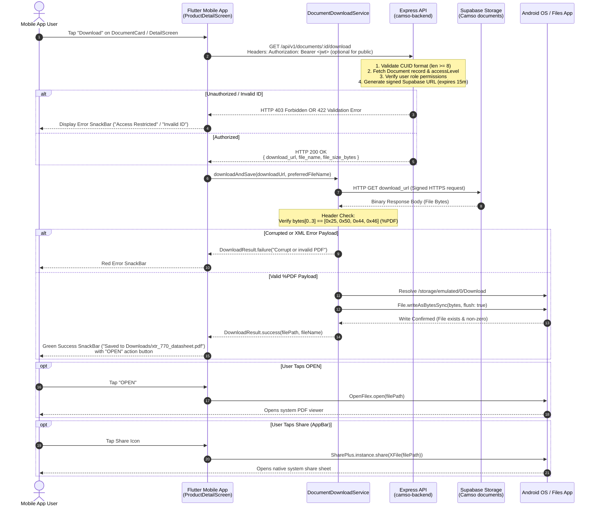
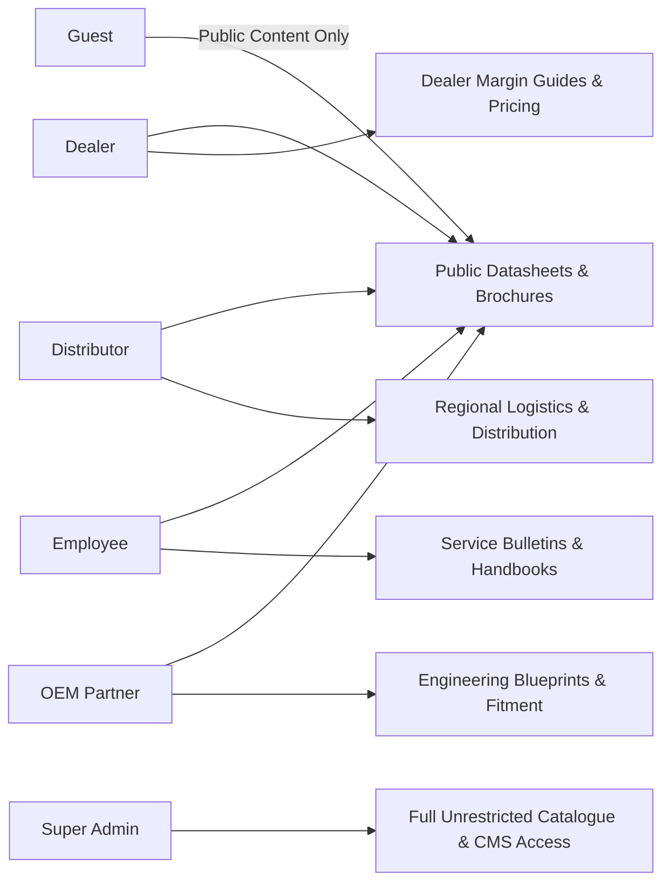

# CAMSO Technical Architecture & Integration Workflow

> **Document Version:** 1.0.0  
> **Target Audience:** Engineering Lead (Aary) & System Architects  
> **Status:** Verified Implementation Baseline  
> **Last Verified:** October 16, 2026  

---

## 1. High-Level Architecture Overview

CAMSO by CEAT follows a three-tier client-server architecture with managed cloud persistence:

```mermaid
graph TD
    subgraph Clients ["Client Applications"]
        Flutter["Flutter Mobile App\n(Android / iOS / Web)\nFrontend/"]
        CMS["React / Vite Admin CMS\n(Web Dashboard)\ncamso-backend/admin-dashboard/"]
    end

    subgraph API ["Backend API Layer (Node.js / Express 5)"]
        Router["Central Router (/api/v1)"]
        AuthMiddleware["JWT Auth & RBAC Middleware"]
        Controllers["Controllers\n(Documents, Products, Dealers, Content)"]
    end

    subgraph Data ["Persistence & Cloud Storage (Supabase)"]
        Postgres[("Supabase PostgreSQL Database\n(Prisma ORM Models)")]
        Storage[("Supabase Private Storage\nBucket: 'Camso documents'")]
    end

    Flutter -->|HTTPS / REST API| Router
    CMS -->|HTTPS / REST API| Router
    Router --> AuthMiddleware
    AuthMiddleware --> Controllers
    Controllers -->|SQL via Prisma Client| Postgres
    Controllers -->|Supabase SDK / Signed URLs| Storage
    Storage -.->|Direct Binary Stream\n(Signed HTTPS GET)| Flutter
```

---

## 2. Component Roles & Integration Interfaces

### 2.1 Flutter Mobile App (`Frontend`)
- **Framework:** Flutter 3.47.2 / Dart 3.13.2
- **State Management:** Provider pattern (`AppState` in `lib/state/app_state.dart`).
- **Network Engine:** `ApiClient` (`lib/core/api/api_client.dart`) using `package:http`.
  - Base URL defaults to: `https://camso-backend.onrender.com/api/v1`.
  - Configurable via `--dart-define=API_BASE_URL=...`.
  - Request timeout: 15 seconds to gracefully handle Render cold starts.
- **Key Modules:**
  - `ProductDetailScreen` (`lib/screens/product_detail_screen.dart`): Product specifications, dimension tables, and dynamic document list.
  - `DocumentDetailScreen` (`lib/screens/document_detail_screen.dart`): Document metadata, authorization gates, and download trigger.
  - `DocumentDownloadService` (`lib/core/download/document_download_service.dart`): File download, `%PDF` byte verification, storage write, open (`OpenFilex`), and share (`SharePlus`).
  - `DealerSupportScreen` (`lib/screens/dealer_support_screen.dart`): Interactive OpenStreetMap locator and Google Maps direction routing.

### 2.2 Express API Backend (`camso-backend`)
- **Runtime:** Node.js v20+ / Express v5.2.1
- **Database Access:** Prisma ORM v6.19.3
- **Primary Modules:**
  - `auth` & `business-auth`: JWT generation, role assignment, bcrypt password verification.
  - `documents`: Document catalogue listing, product-filtered querying, and authorized signed download URL generation.
  - `products`: Product hierarchy, spec filtering, and search.
  - `dealers`: Dealer discovery and geographic querying.
  - `admin`: CMS management routes for documents, categories, and testimonials.

### 2.3 Supabase Cloud Persistence
- **PostgreSQL Database:** Hosts relational models for `Product`, `Document`, `Category`, `User`, `Dealer`, etc.
- **Storage Bucket (`Camso documents`):** Private storage bucket containing raw PDF brochures, datasheets, and service manuals. Direct public access is disabled; downloads require short-lived signed URLs generated by the backend API.

---

## 3. End-to-End PDF Download & Verification Sequence

The diagram below illustrates the exact sequence implemented across Flutter, Express, and Supabase:



---

## 4. Entity Identifier Mapping (CUID vs PID vs Media)

To prevent regression errors like the `Invalid document ID` bug, developers must understand the three distinct identifier namespaces used across CAMSO:

| Identifier Type | Format Example | Generated By | Purpose & Domain |
| :--- | :--- | :--- | :--- |
| **Prisma CUID** | `cmv9jodyx0000uffkydy4c8ij` | Prisma / Backend | Primary Key (`id`) for Database records (`Product.id`, `Document.id`, `Category.id`). Enforced by Joi validation (`min(8)`). |
| **Product PID / SKU** | `XTR770-12-16.5` | Business / Marketing | Human-readable catalogue product code (`Product.pid`). Used for search, QR codes, and legacy UI lookups. |
| **Storage Object Key** | `documents/17289123-xtr770.pdf` | Supabase Storage | File path within the `Camso documents` bucket. Never exposed directly to client; resolved via signed URLs. |

> [!IMPORTANT]
> The backend validation schema requires CUIDs (`length >= 8`). Passing mock IDs like `'d007'` or `'p001'` to `/api/v1/documents/:id/download` triggers HTTP 422. Client code must always pass the Prisma CUID.

---

## 5. Verified API Specification Reference

All endpoints below are verified against the active backend implementation (`camso-backend`):

### 5.1 Document Management

#### `GET /api/v1/documents`
- **Description:** Retrieve published documents with optional filtering.
- **Query Parameters:**
  - `product_id` (string, optional): Filter by associated product CUID.
  - `category` (string, optional): Filter by category slug (e.g. `brochures`, `datasheets`).
  - `q` (string, optional): Text search query against title and description.
  - `page` (number, default: 1): Page index.
  - `pageSize` (number, default: 50): Number of records per page.
- **Response Structure (HTTP 200):**
  ```json
  {
    "success": true,
    "data": [
      {
        "id": "cmv9jodyx0000uffkydy4c8ij",
        "title": "CAMSO XTR 770 Extreme Terrain Tire - Technical Datasheet",
        "type": "Datasheet",
        "category": "brochures",
        "access_level": "public",
        "product_id": "cmv6j48qd0045ufj88qjrshv8",
        "filename": "xtr_770_datasheet.pdf",
        "file_size_bytes": 4214,
        "is_published": true
      }
    ]
  }
  ```

#### `GET /api/v1/documents/:id/download`
- **Description:** Authorize and request signed download URL for document binary.
- **Headers:** `Authorization: Bearer <jwt_token>` (Required if document access level is restricted).
- **Validation:** `:id` must be a valid CUID string (minimum 8 characters).
- **Response Structure (HTTP 200):**
  ```json
  {
    "success": true,
    "data": {
      "download_url": "https://eysewvsbnfzphvgyvwcw.supabase.co/storage/v1/object/sign/Camso%20documents/xtr_770_datasheet.pdf?token=...",
      "file_name": "xtr_770_datasheet.pdf",
      "mime_type": "application/pdf",
      "file_size_bytes": 4214
    }
  }
  ```

---

## 6. Authentication & Role-Based Access Control (RBAC)

The system supports 6 roles enforced both on the backend (`auth.middleware.js`) and in Flutter (`AppState.permissions`):



### Document Access Level Hierarchy:
1. `public`: Accessible to all sessions including unauthenticated Guests.
2. `dealer`: Accessible to `dealer` and `admin`.
3. `distributor`: Accessible to `distributor` and `admin`.
4. `employee`: Accessible to `employee` and `admin`.
5. `oem`: Accessible to `oemPartner` and `admin`.
6. `admin`: Accessible only to `admin`.

---

## 7. Security Boundaries & Token Handling

1. **Storage Isolation:** The Supabase storage bucket `Camso documents` is strictly private. Direct public URL construction fails with HTTP 400/403.
2. **Short-Lived Signed URLs:** The backend generates signed URLs with a 15-minute time-to-live (`expiresIn: 900`). Once expired, Supabase returns an XML access-denied payload, which `DocumentDownloadService` detects and safely reports to the user.
3. **Token Storage:** In Flutter, JWT tokens are stored locally via `shared_preferences`. On 401 Unauthorized responses, `ApiClient` clears the stored session and redirects to `/login`.
4. **No Hardcoded Secrets:** Neither Flutter source code nor version-controlled backend files contain production database passwords or Supabase service-role keys.

---

## 8. Deferred Architectural Considerations (Microservices)

The current architecture is intentionally structured as a modular monolithic Express API with an integrated Prisma ORM client. 

Future microservices separation (e.g., separating Catalogue Service, Authentication Service, and Asset Storage Service into standalone containers) is documented in architectural planning as **deferred work**. It is not required for the current release and should only be evaluated if traffic volume or team boundaries necessitate independent deployment pipelines.
