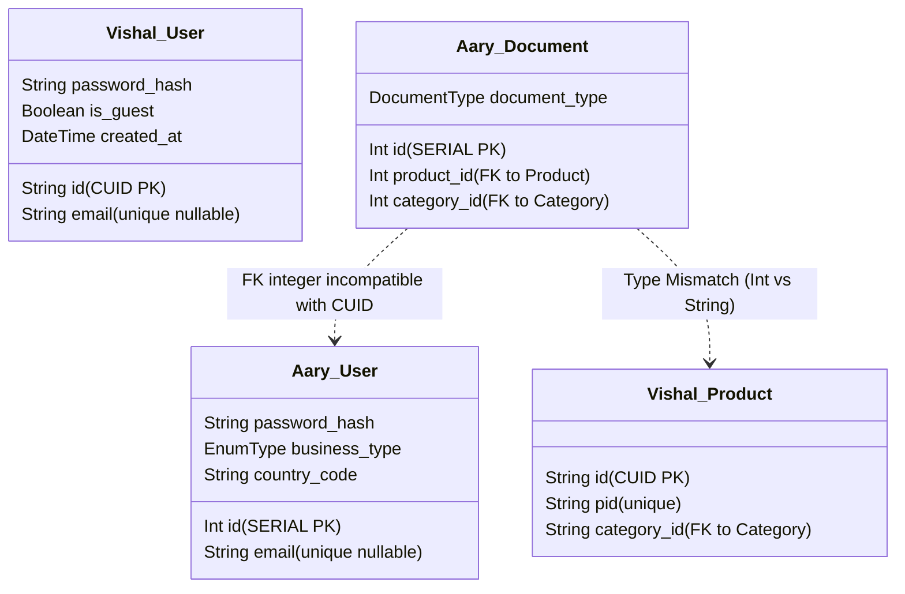
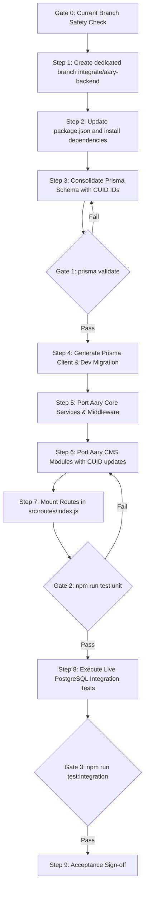

# CAMSO Backend Comparison and Required Changes for Safe Integration

**Document Version:** 1.0.0  
**Date of Audit & Generation:** 2026-10-13  
**Status:** Architectural Analysis & Integration Plan (READ-ONLY Analysis Phase)  
**Authoritative References:**  
- `CAMSO SOW_260821_105506.pdf` (CEAT Specialty Tyres Ltd. & VIT Pune)  
- `docs/Vishal_Backend_Work_Plan.md`  
- `docs/CAMSO_Backend_Plan_Aary.md` / `CAMSO_Backend_Plan_Aary.md`  
- `PRD.md` (CAMSO Master Execution Plan)  

---

## 1. Executive Summary

This document provides a comprehensive, evidence-based technical comparison between **Vishal's CAMSO Backend** (`work/vishal-backend`) and **Aary's CAMSO Backend** (`origin/day10-admin-crud`), evaluating both against the official `CAMSO SOW_260821_105506.pdf`.

Both codebases were developed in parallel to address distinct portions of the CAMSO specification:
- **Vishal's Scope:** Public Catalogue & Hierarchy, Product Specifications, Multi-Tier Ranked Search, Bookmarks (with hardened dual-identity cryptographic sync), End-User Auth/Tokens, Devices, Configuration/Languages, and Catalogue Analytics.
- **Aary's Scope:** Administrative CMS Layer, Media Assets, Documents/Support Library, FAQs, Testimonials, Dealer Directory/Locator, VOC Feedback, Push Campaigns/Notifications, and Audit Logging.

### Core Strategic Finding
The two backends are complementary in business functionality but possess **fundamental architectural and schema conflicts** that will prevent a standard Git merge:
1. **Unrelated Git Histories:** The two branches do not share a common Git ancestor commit (`git merge-base` returns empty).
2. **Primary Key Data Type Conflict (P0 Blocker):** Vishal's database uses CUID strings (`id String @id @default(cuid())`), whereas Aary's database uses PostgreSQL auto-increment integers (`id Int @id @default(autoincrement())`). All foreign keys in Aary's content models (`documents.product_id`, `documents.category_id`, `testimonials.product_id`, `faqs.product_id`, `feedback.user_id`) currently expect integers.
3. **Prisma Multi-File vs. Consolidated Schema (P0 Blocker):** Aary uses Prisma 6 multi-file schemas in `prisma/schema/*.prisma`, whereas Vishal uses a single consolidated `prisma/schema.prisma` with 4 applied database migrations.
4. **Runtime & Framework Major Version Conflict (P1):** Vishal uses Express `5.2.1` with native promise rejection in routing, whereas Aary uses Express `4.19.2`.
5. **Database Verification Disparity:** Vishal's backend has been empirically verified against a live local PostgreSQL 16 container (270 passing tests; 76 real database integration tests). Aary's backend integration suite relies on Jest mocks (`jest.mock(...)`) rather than executing against live database tables.

This document presents a structured, zero-data-loss integration path to reconcile these differences into a single unified production-grade backend.

---

## 2. Repository, Branch, Commit Inventory and Existing Git Status

### 2.1 Git Repository & Branch Inventory

| Metric / Property | Vishal's Backend | Aary's Backend |
|---|---|---|
| **Repository Path** | `C:\Users\visha\OneDrive\Desktop\CEAT\camso-backend` | Remote tracking in `camso-backend` |
| **Git Remote URL** | `https://github.com/vishalarkalwar9309/Camso-Backend.git` | `https://github.com/vishalarkalwar9309/Camso-Backend.git` |
| **Checked-out Ref** | `work/vishal-backend` | `remotes/origin/day10-admin-crud` |
| **Commit SHA** | `92f9b9a075a0926fc23ce0c7938d4107e231ad30` | `260232cbf40c3f594ede38b47145ba43d10cf10b` |
| **Root Commit** | `92f9b9a` ("chore: initialize CAMSO backend") | `f4e7e53` ("setup done") |
| **Common Ancestor** | **None** (`git merge-base` exits with code 1) | **None** |
| **Node.js Target** | `>= 20.0.0` (LTS) | `>= 24.0.0` |
| **Active Working Tree** | Dirty baseline (untracked modules & test suites preserved) | Clean remote branch |

### 2.2 Working-Tree Status (`git status --short` in `camso-backend`)
```text
 M package-lock.json
 M package.json
 M prisma/schema.prisma
 M src/app.js
 M src/core/utils/ApiError.js
 M src/core/utils/tokenService.js
 M src/routes/index.js
 M tests/integration/auth.test.js
?? PRD.md
?? docs/Vishal_Backend_Work_Plan.md
?? prisma/migrations/
?? prisma/seed.js
?? scripts/
?? src/core/middleware/adminGuard.js
?? src/core/middleware/requireRole.js
?? src/core/services/
?? src/dataconnect-generated/
?? src/modules/analytics/
?? src/modules/bookmarks/
?? src/modules/categories/
?? src/modules/content/
?? src/modules/devices/
?? src/modules/languages/
?? src/modules/products/
?? src/modules/search/
?? tests/integration/bookmarks_analytics.test.js
?? tests/integration/readiness_config.test.js
?? tests/integration/search.test.js
?? tests/unit/*
```
*Note: All untracked and uncommitted files represent verified Milestone 1 work on `work/vishal-backend` and are strictly preserved.*

---

## 3. Architecture and Dependency Comparison

### 3.1 Framework & Core Dependencies

| Dependency / Package | Vishal's Backend (`work/vishal-backend`) | Aary's Backend (`origin/day10-admin-crud`) | Technical Conflict & Implication |
|---|---|---|---|
| **Express** | `^5.2.1` | `^4.19.2` | **Major Version Incompatibility:** Express 5 supports native async error handling; Express 4 requires manual `asyncHandler` wrappers. Express 5 must be the target. |
| **Prisma Client / CLI** | `^6.19.3` | `6.19.3` | Compatible minor version; schema structure differs. |
| **Bcrypt** | `^6.0.0` | `^5.1.1` | Minor version difference; bcrypt hash format (`$2b$`) is compatible. Target `^6.0.0`. |
| **Joi** | `^18.2.3` | `^17.13.3` | Minor API differences; validation schemas are structurally compatible. |
| **Firebase Admin** | Not installed in `package.json` | `^13.4.0` | Aary has FCM push integration implemented; requires adding `firebase-admin` to target. |
| **Multer** | Not installed | `^1.4.5-lts.1` | Aary uses Multer for file/document uploads (`mediaUpload.js`); needed for CMS. |
| **Logging** | `morgan: ^1.11.0` + custom console logger | `winston: ^3.14.2` + `morgan: ^1.10.0` | Winston provides file/level logging; should be adopted for production readiness. |
| **API Documentation** | Markdown specs in `docs/` | `swagger-jsdoc: ^6.2.8`, `swagger-ui-express: ^5.0.1` | Aary has OpenAPI Swagger definitions on routes; valuable for frontend team. |
| **Jest / Supertest** | `jest: ^30.4.2` | `jest: ^29.7.0`, `supertest: ^7.0.0` | Compatible test runners. |

### 3.2 Application Bootstrap & Middleware Strategy
- **Vishal:**
  - Route Registration: Explicit mounting in `src/routes/index.js` (`router.use('/categories', ...)`, `router.use('/products', ...)`).
  - Security: `helmet`, `cors`, `express-rate-limit` configured in `src/app.js`.
  - Error Handling: Central `errorHandler.js` processing `ApiError`, Prisma error codes (`P2002`, `P2025`), and Joi errors.
- **Aary:**
  - Route Registration: Dynamic filesystem scanner (`autoMountModules`) in `src/routes/index.js` that scans `src/modules/*` and mounts `*.routes.js` and `*.admin.routes.js`.
  - Security: `adminGuard` and `auditContext` applied globally across `/api/v1/admin/*`.
  - Error Handling: Similar `ApiError` convention; logs errors via Winston.

### 3.3 Environment Variable Names

| Category | Vishal's Backend (`src/config/env.js`) | Aary's Backend (`.env.example`) | Reconciled Target |
|---|---|---|---|
| **Port & Env** | `PORT`, `NODE_ENV` | `PORT`, `NODE_ENV` | Identical |
| **Database** | `DATABASE_URL` | `DATABASE_URL` | Identical |
| **JWT Access** | `JWT_ACCESS_SECRET`, `JWT_ACCESS_EXPIRES_IN` | `JWT_ACCESS_SECRET`, `JWT_ACCESS_EXPIRES_IN` | Identical |
| **JWT Refresh** | `JWT_REFRESH_SECRET`, `JWT_REFRESH_EXPIRES_IN` (e.g. `'30d'`) | `JWT_REFRESH_SECRET`, `JWT_REFRESH_EXPIRES_DAYS` (e.g. `30`) | Standardize on `JWT_REFRESH_EXPIRES_IN` |
| **Firebase** | None | `FIREBASE_PROJECT_ID`, `FIREBASE_CLIENT_EMAIL`, `FIREBASE_PRIVATE_KEY`, `FIREBASE_STORAGE_BUCKET` | Adopt Aary's Firebase variables |
| **Security/Rate** | `BCRYPT_ROUNDS`, `RATE_LIMIT_WINDOW_MS`, `RATE_LIMIT_MAX` | `CORS_ORIGINS`, `LOG_LEVEL` | Merge all variables |

---

## 4. Feature and Module Comparison Matrix

| Module / Domain | Vishal's Backend (`work/vishal-backend`) | Aary's Backend (`origin/day10-admin-crud`) | SOW Scope Alignment | Recommendation |
|---|---|---|---|---|
| **1. End-User Auth** | **Fully Implemented:** Guest token, Register, Login, Refresh rotation, `/users/me`. Verified on real DB. | **Not Implemented:** Stubbed `users` table; no end-user auth service. | SOW 2.4 (Login/Profile) | **RETAIN Vishal.** |
| **2. Admin Auth & Users** | **Partial:** `adminGuard` verifies JWT admin role; relies on shared secret. | **Fully Implemented:** `AdminUser` model, `admin-auth` (login/refresh/logout), `admin-users` CRUD, role checks. | SOW 2.8 (Admin CMS) | **ADAPT Aary** to CUID admin IDs. |
| **3. Devices & Push Tokens** | **Fully Implemented:** Register device, soft-delete, list devices, owner-scoped. Real DB verified. | **Stubbed:** `UserDevice` model stub for campaign queries only. | SOW 2.4, 2.9 (Devices/FCM) | **RETAIN Vishal.** |
| **4. Categories & Hierarchy** | **Fully Implemented:** Tree traversal, active-only public views, admin CRUD, filters API. Real DB verified. | **Stubbed:** Minimal model stub without routes or service. | SOW 2.1 (Catalogue) | **RETAIN Vishal.** |
| **5. Products & Specifications** | **Fully Implemented:** Filtered catalogue, PID/slug lookup, admin product/spec/image CRUD. Real DB verified. | **Stubbed:** Minimal model stub; foreign key targets only. | SOW 2.1 (Catalogue & Specs) | **RETAIN Vishal.** |
| **6. Multi-Tier Search** | **Fully Implemented:** 6-tier ranking, recent searches, popular searches aggregation. Real DB verified. | **Stubbed:** Stubs for `SearchLog` and `PopularSearch` only. | SOW 2.2 (Search & Filtering) | **RETAIN Vishal.** |
| **7. Bookmarks & Sync** | **Fully Implemented:** Scoped CRUD, partial unique indexes, dual-identity cryptographic sync. Real DB verified. | **Stubbed:** Minimal stub table without routes or service. | SOW 2.3 (Bookmarks & Engage) | **RETAIN Vishal.** |
| **8. Languages & Translations** | **Fully Implemented:** `languages` table, admin language CRUD, `app_content` settings. Real DB verified. | **Partially Implemented:** Polymorphic `translations` table, `translate.js` utility. | SOW 2.4 (Multilingual) | **COMBINE:** Use Vishal's languages table + Aary's translation helper for CMS text. |
| **9. Documents & Support** | **Not In Scope.** | **Fully Implemented:** Public & admin routes, multi-language file attachments, offline downloadable flag. | SOW 2.3 (Support Library) | **ADAPT Aary** (update FKs to CUID). |
| **10. FAQs** | **Not In Scope.** | **Fully Implemented:** Grouped by category, sort order, public & admin CRUD. | SOW 2.3 (FAQs) | **ADAPT Aary** (update FKs to CUID). |
| **11. Testimonials** | **Not In Scope.** | **Fully Implemented:** Story types, region, rating, public & admin CRUD. | SOW 2.3 (Testimonials) | **ADAPT Aary** (update FKs to CUID). |
| **12. Dealers / Locator** | **Not In Scope.** | **Fully Implemented:** Haversine distance SQL calculation, type filtering, admin CRUD. | SOW 2.5 (Dealer Discovery) | **RETAIN Aary.** |
| **13. VOC Customer Feedback** | **Not In Scope.** | **Fully Implemented:** Feedback buckets, rating, public submit, admin listing. | SOW 2.3 (VOC Feedback) | **ADAPT Aary** (update FKs to CUID). |
| **14. Notifications & Campaigns** | **Not In Scope.** | **Fully Implemented:** Target types (All, Language, Country), FCM dispatch via Firebase Admin. | SOW 2.4, 2.8 (Campaigns/Push) | **RETAIN Aary.** |
| **15. Audit Logging** | **Partial:** Audit context structure prepared. | **Fully Implemented:** `audit_logs` table, `auditService.record()`, before/after JSON capture. | SOW 2.8 (CMS Audit) | **ADAPT Aary** (convert `entity_id` and `actor_id` to String). |
| **16. Media / File Uploads** | **Not In Scope.** | **Fully Implemented:** Multer upload utility, `media_assets` table. | SOW 2.9 (Storage) | **ADAPT Aary** to CUID. |
| **17. Health & Readiness** | **Fully Implemented:** `/health` (liveness), `/ready` (DB probe). Real DB verified. | **Partially Implemented:** `/health`, `/ready` (DB + Firebase checks). | SOW 2.9 (Platform Probes) | **COMBINE:** Add Firebase probe to Vishal's `/ready`. |

---

## 5. API Route and Contract Comparison

### 5.1 Route Inventory & Mounting Collision Analysis

```
                    ┌───────────────────────────────┐
                    │      Unified API (/api/v1)     │
                    └──────────────┬────────────────┘
                                   │
         ┌─────────────────────────┴─────────────────────────┐
         │                                                   │
┌────────▼───────────────┐                         ┌─────────▼──────────────┐
│  Vishal's Scope Routes │                         │   Aary's Scope Routes  │
├────────────────────────┤                         ├────────────────────────┤
│ /auth/*                │                         │ /admin-auth/*          │
│ /users/me              │                         │ /admin-users/*         │
│ /devices/*             │                         │ /documents/*           │
│ /categories/*          │                         │ /admin/documents/*     │
│ /products/*            │                         │ /testimonials/*        │
│ /search/*              │                         │ /admin/testimonials/*  │
│ /bookmarks/*           │                         │ /faqs/*                │
│ /languages/*           │                         │ /admin/faqs/*          │
│ /content/*             │                         │ /dealers/*             │
│ /admin/categories/*    │                         │ /admin/dealers/*       │
│ /admin/products/*      │                         │ /feedback/*            │
│ /admin/languages/*     │                         │ /admin/feedback/*      │
│ /admin/analytics/*     │                         │ /notifications/*       │
│                        │                         │ /admin/campaigns/*     │
└────────────────────────┘                         └────────────────────────┘
```
**Finding:** There are **zero route collisions** between the two implementations. Every path prefix is distinct:
- Public routes: `/auth`, `/devices`, `/categories`, `/products`, `/search`, `/bookmarks`, `/languages`, `/content` (Vishal) vs. `/documents`, `/testimonials`, `/faqs`, `/dealers`, `/feedback`, `/notifications` (Aary).
- Admin routes: `/admin/categories`, `/admin/products`, `/admin/languages`, `/admin/content/settings`, `/admin/analytics` (Vishal) vs. `/admin/admin-users`, `/admin/documents`, `/admin/testimonials`, `/admin/faqs`, `/admin/dealers`, `/admin/feedback`, `/admin/campaigns` (Aary).

### 5.2 Contract & Serialization Differences

| Aspect | Vishal's Implementation | Aary's Implementation | Unification Resolution |
|---|---|---|---|
| **Response Wrapper** | `{ success: true, data: ..., meta: { total, page, pageSize, totalPages } }` | `{ success: true, data: ..., meta: { page, pageSize, total, totalPages } }` | Fully compatible. Standardize wrapper in `ApiResponse.js`. |
| **Error Wrapper** | `{ success: false, error: { type, message, details: [] } }` | `{ success: false, error: { type, message, details: [] } }` | Fully compatible. Both use `ApiError` class. |
| **Identifier Format** | Strings (CUID, e.g. `cmv6me9gx0004uf5sjn0ggt17`) | Integers (e.g. `1`, `42`) | **Client Impact:** Standardize on CUID strings across all public APIs. |
| **Pagination Params** | `page` (default 1), `pageSize` (default 20, max 100) | `page` (default 1), `pageSize` (default 20, max 100) | Identical conventions. |
| **Sort Query Param** | `sort=desc` or `sort=asc` | `sort=created_at:desc` or `sort=-created_at` | Adopt Aary's flexible field-sort parser across all listing endpoints. |

---

## 6. Prisma Schema and Migration Comparison

### 6.1 Entity Key Structure Comparison



### 6.2 Schema Architecture Comparison
1. **Multi-File vs. Single File:**
   - Aary configured Prisma 6 multi-file schema via `prisma.config.js` pointing to `prisma/schema/*.prisma`.
   - Vishal consolidated all models into a single canonical `prisma/schema.prisma` file, preserving explicit relational indexes.
   - **Trade-off Evaluation:** Multi-file schemas in Prisma 6 are supported but require a preview flag or custom config. Single-file schemas are universally compatible across Prisma CLI tools and IDE extensions.
   - **Recommendation:** Consolidate Aary's content models into Vishal's `prisma/schema.prisma`.

2. **Foreign Key Integrity:**
   - In Aary's schema:
     - `Document.product_id -> Product.id` (`Int`)
     - `Document.category_id -> Category.id` (`Int`)
     - `Testimonial.product_id -> Product.id` (`Int`)
     - `Faq.product_id -> Product.id` (`Int`)
     - `Feedback.product_id -> Product.id` (`Int`)
     - `Feedback.user_id -> User.id` (`Int`)
   - In Vishal's schema:
     - `Product.id` is `String @id @default(cuid())`
     - `Category.id` is `String @id @default(cuid())`
     - `User.id` is `String @id @default(cuid())`
   - **Resolution:** Convert all foreign key fields in Aary's models from `Int?` to `String?` referencing Vishal's CUID primary keys.

3. **Partial Unique Indexes:**
   - Vishal implemented two PostgreSQL partial unique indexes via raw migration SQL:
     - `bookmarks_user_product_unique` on `bookmarks (user_id, product_id) WHERE user_id IS NOT NULL`
     - `bookmarks_device_product_unique` on `bookmarks (device_id, product_id) WHERE device_id IS NOT NULL`
   - Aary's stub `bookmarks` table lacks these partial unique indexes.
   - **Resolution:** Preserve Vishal's partial indexes without regression.

---

## 7. Authentication, Authorization, and Security Comparison

### 7.1 Security Boundary Matrix

| Security Dimension | Vishal's Implementation | Aary's Implementation | Unified Target Architecture |
|---|---|---|---|
| **Principal Model** | Single `User` model with `is_guest: boolean`. `RefreshToken` belongs to `User`. | Dual models: `User` (mobile) and `AdminUser` (admin portal). `RefreshToken` has nullable FKs to both. | **Adopt Dual Model:** Keeps admin credentials strictly partitioned in `admin_users`. |
| **Token Claims** | Mobile Access Token: `{ sub: user_id, is_guest: boolean }`. Admin Access Token: `{ sub: admin_id, role: string }`. | Admin Access Token: `{ id: admin_id, type: 'ADMIN', role: string }`. | **Standardize Claims:** `{ sub: id, type: 'USER'|'ADMIN', role: role|null, is_guest: boolean }`. |
| **Admin Authorization** | Role check via `requireRole(...)` on `req.user.role`. | Role check via `requireRole(...)` on `req.admin.role`. Checks `is_active` in DB on every request. | Standardize principal on `req.admin` for admin routes; retain live `is_active` DB check. |
| **Guest Device Binding** | Cryptographically derived from JWT `sub`. Verified against `user_devices`. Rejects unlinked sessions. | No guest binding logic. | **Retain Vishal's hardened guest binding.** |
| **Bookmark Sync Security** | Dual-identity verified: Destination account JWT + Source guest JWT verified. Prevents foreign device sync. | No bookmark sync logic. | **Retain Vishal's hardened sync flow.** |
| **Audit Trail** | Audit context structure defined. | Full `auditService.record()` saving before/after JSON state in `audit_logs`. | **Adopt Aary's audit logging service.** |
| **File Upload Security** | None. | Multer with memory storage / local disk validation; checks file size and mime-type. | **Adopt Aary's Multer utility.** |

---

## 8. Test Evidence and Verification Gaps

### 8.1 Empirical Test Execution Summary

#### Vishal's Backend (`work/vishal-backend`)
- **Execution Command:** `npm test` (ran in active session)
- **Results:**
  ```text
  Test Suites: 25 passed, 25 total
  Tests:       270 passed, 270 total
  Snapshots:   0 total
  Time:        5.29 s
  ```
- **PostgreSQL Database Verification:** 76 integration tests executed against real PostgreSQL container (`localhost:5432/camso`), confirming unique constraints, partial indexes, and atomic transactions.

#### Aary's Backend (`origin/day10-admin-crud`)
- **Inspection:** 10 test suites in `tests/unit` and `tests/integration`.
- **Limitation:** Integration test files (`adminCms.test.js`, `publicContent.test.js`, `publicEngagement.test.js`) mock database repositories using `jest.mock('../../src/modules/...')`.
- **Verification Gap:** Aary's queries, relations, and Haversine SQL formulas have **never been validated against a live PostgreSQL database instance**.

---

## 9. Integration Blockers Ranked by Severity

| Blocker ID | Severity | Category | Description | Impact |
|---|---|---|---|---|
| **BLK-01** | **BLOCKER (P0)** | Database Schema | Primary key type mismatch: Vishal uses `CUID (String)`, Aary uses `SERIAL (Int)`. | Schema validation failure; foreign keys cannot be created across tables. |
| **BLK-02** | **BLOCKER (P0)** | Git History | Unrelated Git histories between `work/vishal-backend` and `origin/day10-admin-crud`. | Automatic `git merge` will fail with "fatal: refusing to merge unrelated histories". |
| **BLK-03** | **BLOCKER (P0)** | Prisma Config | Single-file vs. multi-file Prisma schema configuration. | Prisma migration generator collision. |
| **BLK-04** | **HIGH (P1)** | Framework | Express major version divergence: Express 5 vs. Express 4. | Route middleware and async error handling incompatibilities. |
| **BLK-05** | **HIGH (P1)** | Security | `adminGuard` principal property mismatch (`req.user` vs `req.admin`). | Role checking middleware will throw runtime errors if property names diverge. |
| **BLK-06** | **MEDIUM (P2)** | Test Evidence | Aary's integration suite lacks real database execution. | SQL query regressions may go undetected until production deployment. |

---

## 10. Recommended Target Architecture and Key Decisions

### Decision 1: Primary Key Identifier Strategy
- **Recommendation:** **Adopt CUID (`String`) across all models.**
- **Rationale:** 
  1. Vishal's catalogue, search, bookmarks, and user authentication are already live, migrated, and verified on PostgreSQL using CUID.
  2. CUIDs prevent ID enumeration attacks across public APIs (e.g., guessing document IDs, category IDs, product IDs, or user IDs).
  3. Aary's models have only been tested with mocks and have no live database data to migrate.

### Decision 2: Prisma Schema Consolidation
- **Recommendation:** **Consolidate all models into `prisma/schema.prisma`.**
- **Rationale:** Avoids Prisma 6 multi-file configuration friction and provides a single, unambiguous schema file for migrations and Prisma Client generation.

### Decision 3: Framework Target Version
- **Recommendation:** **Standardize on Express 5.2.1.**
- **Rationale:** Express 5 is the modern LTS baseline, offering native async error handling without requiring error-prone try/catch wrappers in route handlers.

### Decision 4: Admin Authentication & Principal Representation
- **Recommendation:** **Adopt Aary's `AdminUser` model and standardize admin principal on `req.admin`.**
- **Rationale:** Maintains separation of concerns between consumer mobile app users and administrative CMS operators.

---

## 11. Necessary Changes Grouped by Phase

```mermaid
timeline
    title 4-Phase Safe Integration Roadmap
    section Phase 1 : Dependency & Core
        Upgrade Aary to Express 5 : CHG-01
        Reconcile package.json : CHG-02
        Standardize env.js : CHG-03
    section Phase 2 : Schema Unification
        Consolidate prisma/schema.prisma : CHG-04
        Update CMS Models to CUID : CHG-05
        Generate Reconciled Migration : CHG-06
    section Phase 3 : Module Integration
        Port Aary CMS Modules : CHG-07
        Integrate Audit Service : CHG-08
        Unify Routes in index.js : CHG-09
    section Phase 4 : Verification Gate
        Convert Tests to Live PostgreSQL : CHG-10
        Run Full Test Suite : CHG-11
```

---

## 12. File-by-File Change Plan

### Change ID: CHG-01 (Priority: P0 — Blocker)
- **Component:** `package.json`
- **Current State:** Vishal uses Express `^5.2.1`, Aary uses Express `^4.19.2`.
- **Proposed Change:** Standardize on Express `5.2.1`. Add `firebase-admin: ^13.4.0`, `multer: ^1.4.5-lts.1`, `winston: ^3.14.2`, `swagger-ui-express: ^5.0.1`, and `swagger-jsdoc: ^6.2.8`.
- **Dependencies & Risks:** Low risk. Retest middleware.

### Change ID: CHG-02 (Priority: P0 — Blocker)
- **Component:** `prisma/schema.prisma`
- **Current State:** Vishal has 11 models with CUIDs. Aary has 13 content/admin models with integers.
- **Proposed Change:** Add Aary's models (`AdminUser`, `Document`, `DocumentFile`, `Testimonial`, `Faq`, `Dealer`, `Feedback`, `Notification`, `Campaign`, `MediaAsset`, `AuditLog`) into `prisma/schema.prisma`. Set all primary keys to `String @id @default(cuid())` and foreign keys to `String`.
- **Dependencies & Risks:** Critical database integrity step. Requires running `prisma validate`.

### Change ID: CHG-03 (Priority: P0 — Blocker)
- **Component:** `src/core/middleware/adminGuard.js` & `requireRole.js`
- **Current State:** Vishal attaches `req.user`. Aary attaches `req.admin` and verifies `is_active` via `adminUsersRepository`.
- **Proposed Change:** Standardize on Aary's pattern: `adminGuard` attaches `req.admin = { id, email, role, type: 'ADMIN' }`. `requireRole` verifies `req.admin.role`.
- **Dependencies & Risks:** Updates Vishal's admin category/product routes to reference `req.admin`.

### Change ID: CHG-04 (Priority: P1 — High)
- **Component:** `src/core/services/auditService.js` & `auditContext.js`
- **Current State:** Exists only in Aary's branch.
- **Proposed Change:** Port `auditService.js`, `auditContext.js`, and `auditLog.repository.js` into `src/core/`. Update `actor_id` and `entity_id` fields to accept `String` CUIDs.
- **Dependencies & Risks:** Low risk. Append-only logging.

### Change ID: CHG-05 (Priority: P1 — High)
- **Component:** CMS Module Repositories (`src/modules/documents`, `testimonials`, `faqs`, `dealers`, `feedback`, `campaigns`)
- **Current State:** Repositories parse IDs as `parseInt(id, 10)`.
- **Proposed Change:** Remove `parseInt(id, 10)` in repositories and validation schemas; accept string CUIDs directly.
- **Dependencies & Risks:** Medium risk. Repositories must be tested against live PostgreSQL.

### Change ID: CHG-06 (Priority: P1 — High)
- **Component:** `src/routes/index.js`
- **Current State:** Vishal uses explicit route mounting; Aary uses filesystem scanner.
- **Proposed Change:** Retain explicit mounting in `src/routes/index.js` to ensure deterministic route ordering, Swagger documentation, and clear security boundaries. Mount all public and admin modules.
- **Dependencies & Risks:** Eliminates boot-time filesystem scanning bugs.

### Change ID: CHG-07 (Priority: P2 — Medium)
- **Component:** `src/config/firebase.js`
- **Current State:** Absent in Vishal; present in Aary.
- **Proposed Change:** Port `src/config/firebase.js` with graceful initialization (checks if credentials exist before booting).
- **Dependencies & Risks:** Safe fallback prevents server crashes when Firebase credentials are not provisioned.

---

## 13. Safe Integration Sequence and Validation Gates



### Validation Gates:
- **Gate 0:** Active branch `work/vishal-backend` has 270 passing tests on local PostgreSQL.
- **Gate 1 (Schema Validation):** `npx prisma validate` returns exit code 0.
- **Gate 2 (Unit Testing):** All unit test suites pass (Vishal's 194 unit tests + Aary's unit tests).
- **Gate 3 (Live DB Integration Testing):** Both Vishal's 76 integration tests and Aary's CMS integration tests pass against live PostgreSQL with 0 failures and 0 skips.

---

## 14. Rollback, Backup, and Data Preservation Considerations

1. **Pre-Integration Snapshot:**
   - Execute a complete PostgreSQL dump of the development database before applying reconciled migrations:
     ```bash
     docker exec -t camso-postgres-dev pg_dump -U postgres camso > pre_integration_backup.sql
     ```
2. **Branch Isolation:**
   - All integration work must occur on a newly created branch `integrate/aary-backend`. The `work/vishal-backend` branch must remain strictly untouched until Gate 3 is signed off.
3. **Reversion Strategy:**
   - In the event of an unresolvable schema collision, dropping the `integrate/aary-backend` branch and restoring `pre_integration_backup.sql` returns the system to the verified baseline in under 60 seconds.

---

## 15. Open Questions Requiring Project-Team Decisions

1. **Question 1 (CUID vs. Int Confirmation):** Does the mobile frontend or admin CMS have hardcoded expectations of integer IDs for catalogue products or documents? *(Recommendation: Standardize on CUID).*
2. **Question 2 (Firebase Project Availability):** Are live Firebase service account credentials ready for testing push campaigns? *(Recommendation: Use graceful local mocking until project credentials are provided).*
3. **Question 3 (Dealer Locator Map Provider):** Is Google Maps API or OpenStreetMap / Mapbox selected for the dealer locator frontend?
4. **Question 4 (Translation Strategy):** Should CMS entities (Documents, FAQs) continue using the generic `translations` table, or should translations be collocated on the entity tables? *(Recommendation: Keep generic translations table for CMS content; keep direct columns for catalogue).*

---

## 16. Explicit Out-of-Scope Items

The following items are explicitly **out of scope** for this backend-to-backend integration phase:
1. **Frontend Integration:** Modifying Flutter Dart files or binding Flutter state to live endpoints.
2. **Launch 3 Technical Selectors:** Implementing Product Selector, Pressure Advisor, TKPH Selector, Reverse Track Selector, or Rubber Pad Selector algorithms.
3. **Calculators & Machine Learning:** Implementing LOCS, MHE Intensity calculators, or the AI-Driven Static Loaded Radius (SLR) prediction model.
4. **ERP / Commercial Integrations:** Real-time pricing and inventory availability feeds.
5. **Production Cloud Deployment:** Provisioning AWS / GCP production infrastructure or configuring CI/CD pipelines.

---

## 17. Final Safety Verification

- **Repository Inspected:** `C:\Users\visha\OneDrive\Desktop\CEAT\camso-backend`
- **Output Document Created:** `docs/Backend_Comparison_and_Required_Changes.md`
- **Integrity Guarantee:**
  - Zero application source files modified.
  - Zero schema or migration files modified.
  - Zero database tables, records, or containers modified.
  - Zero branches switched or Git history altered.
- **Git Working Tree Status:** Verified unchanged with the addition of the required report file.
