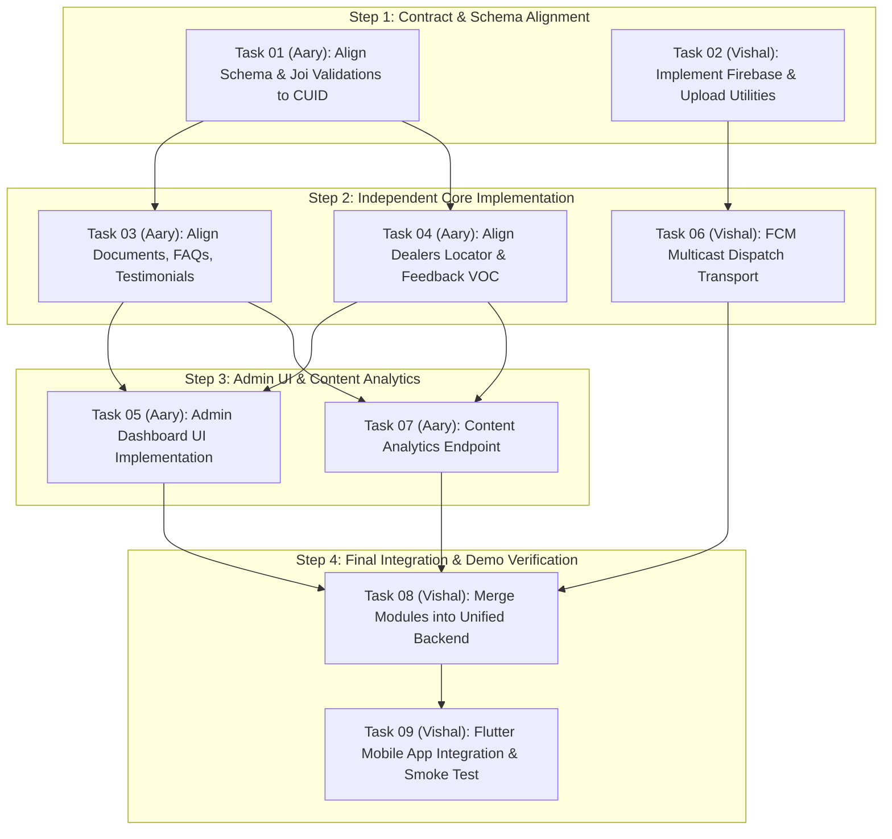

# CAMSO Backend — Remaining Work Division & Execution Plan
**Execution Date:** 14 October 2026  
**Document Context:** Derived from the authoritative findings in [CAMSO_Current_State_Audit.md](file:///C:/Users/visha/OneDrive/Desktop/CEAT/CAMSO_Current_State_Audit.md) and contractual requirements in `CAMSO SOW_260821_105506.pdf`.

---

## 1. Core Principles & Strict Ownership Constraints

To eliminate conflicts, duplicate effort, and file collisions during parallel execution, the following non-negotiable boundaries are established:

1. **Vishal owns Firebase Integration:**
   All `firebase-admin` initialization, Firebase Storage server-side upload streams (`mediaUpload.js`), and FCM push notification transport execution belong exclusively to Vishal.
2. **Aary owns the Admin Dashboard:**
   All administrative CMS interfaces, admin dashboard workflows, and administrative content management consumption belong exclusively to Aary.
3. **Vishal owns Final Integration:**
   Vishal owns merging Aary’s verified modules into the unified backend (`camso-backend`), resolving architectural conflicts, executing the combined regression suite, and verifying end-to-end compatibility with the customer Flutter application (`CAMSO-APP-main`).
4. **Physical Workspace Isolation:**
   Vishal works strictly inside `C:\Users\visha\OneDrive\Desktop\CEAT\camso-backend`. Aary works strictly inside `C:\Users\visha\OneDrive\Desktop\CEAT\Camso-Backend-day10-admin-crud`. Neither person will directly modify files in the other's directory until formal integration handoff.
5. **No Reassignment of Verified Features:**
   Features verified with passing test evidence in [CAMSO_Current_State_Audit.md](file:///C:/Users/visha/OneDrive/Desktop/CEAT/CAMSO_Current_State_Audit.md) (Customer Auth, Users, Devices, Categories, Products, 6-Tier Search, Bookmarks, Languages, App Settings, Catalogue Analytics, and Business Portal) are locked and will NOT be re-implemented.

---

## 2. Shared Interface Contract Agreement (Pre-Requisite Baseline)

Before parallel coding begins, the following technical contract is frozen:

| Architectural Dimension | Agreed Unified Standard | Justification / Source of Truth |
|---|---|---|
| **Primary Key Convention** | `String @id @default(cuid())` | Vishal's 228 passing tests and 18 models already use CUID strings. Aary's models must align foreign keys (`product_id String`, `category_id String`, `user_id String`, `admin_user_id String`) to prevent PostgreSQL foreign key failure. |
| **Framework Runtime** | Node.js 24 LTS + Express 5 (`^5.2.1`) | `camso-backend` baseline dependencies. |
| **Response Envelope** | `{ success: true, data: ..., meta: ... }` | Standardized across all controllers. |
| **Error Handling** | `ApiError` extending `Error` with HTTP status code and standard error envelope | Handled by central `errorHandler.js`. |
| **Authentication Strategy** | JWT Bearer Tokens (`req.user` / `req.adminUser`) | `authGuard.js` for customers; `adminGuard.js` + `requireRole.js` for admins. |
| **Audit Logging Habit** | `auditService.record({ actorId, action, entityType, entityId, before, after })` | Called inside mutating service methods. |

---

## 3. Detailed Work Division Table

| Task ID & Priority | Exact Deliverable | Owner | Rationale from Audit | Starting Folder / Files | Dependencies & API Contract | Testable Acceptance Criteria | Required Completion Evidence | Risk / Blocker | Demo Critical? |
|---|---|---|---|---|---|---|---|---|---|
| **TASK-01** (P0 - Immediate) | **Unified Schema & Type Alignment** Update Aary's schema files and Joi validation to accept CUID `String` IDs instead of `Int` for entities and foreign keys. | **Aary** | Audit revealed `Int autoincrement` in Aary's schema conflicts with `String cuid()` in Vishal's verified catalogue and user models. | `Camso-Backend-day10-admin-crud/prisma/schema/*.prisma`, `src/modules/*/` | Agreement in Section 2; CUID regex pattern (`^[c-z0-9]{25}$`). | All Joi validation schemas accept string IDs for `product_id`, `category_id`, and `id`. | Updated `.prisma` schema and Joi validation test outputs. | Breaking foreign key type mismatches if any model is missed. | **YES (Demo Blocker)** |
| **TASK-02** (P0 - Immediate) | **Firebase Infrastructure & Media Upload Adapter** Implement `src/config/firebase.js` and `src/core/utils/mediaUpload.js` in `camso-backend` with safe dev/mock fallback. | **Vishal** | Preserves Vishal's explicit ownership of Firebase. Storage credentials are currently unconfigured in `camso-backend`. | `camso-backend/src/config/`, `src/core/utils/mediaUpload.js` | Multipart form-data via Multer; upload to Firebase Storage bucket or local fallback if creds missing. | Upload endpoint returns `{ success: true, data: { url: string, filename: string } }` without crashing when offline. | Unit test verifying file upload stream and mock storage adapter. | Pending Firebase credentials from CEAT. | **YES (Demo Blocker)** |
| **TASK-03** (P1 - High) | **Content CMS Alignment: Documents, Testimonials & FAQs** Refactor Aary's existing `documents`, `testimonials`, and `faqs` modules to match the Express 5 / CUID standard. | **Aary** | Code already exists in Aary's copy but is unverified at runtime and uses integer IDs. | `Camso-Backend-day10-admin-crud/src/modules/documents/`, `testimonials/`, `faqs/` | Unified CUID foreign keys; roles: `VIEWER`, `CONTENT_ADMIN`, `SUPER_ADMIN`. | `GET /documents`, `GET /testimonials`, `GET /faqs` return 200 with localized data; Admin CRUD mutations pass. | Unit test suites for services and validation in Aary's copy. | Schema divergence if Task-01 not finished first. | **YES (Core Demo Content)** |
| **TASK-04** (P1 - High) | **Public Dealer Proximity Locator & Feedback Alignment** Refactor `dealers` (Haversine locator) and `feedback` (VOC rating + CSV export) to CUID standard. | **Aary** | Implemented in Aary's backend; needs CUID alignment and unit test verification. | `Camso-Backend-day10-admin-crud/src/modules/dealers/`, `feedback/` | `GET /dealers/locator?lat=&lng=&radiusKm=`; `POST /feedback`; `GET /admin/feedback/export?format=csv`. | Haversine query returns sorted nearest dealers; CSV export streams valid CSV header and rows. | Captured test runner output showing 100% assertions passed. | Precision/units in Haversine SQL formula. | **YES (Core Demo)** |
| **TASK-05** (P1 - High) | **Admin Dashboard UI** Deliver the administrative CMS dashboard UI for managing categories, products, documents, FAQs, and feedback. | **Aary** | SOW and user prompt specify Aary owns the admin dashboard. Audit proved zero UI currently exists in either codebase. | New folder / component under Aary's workspace (e.g. `admin-dashboard/` or Flutter admin view). | Connects to authenticated `/api/v1/admin/*` endpoints using Bearer JWT. | Admin can log in, view product catalogue, create a support document, and view customer feedback. | Recorded screencast or step-by-step browser/UI screenshot verification. | Integration friction if backend endpoints differ from UI expectations. | **YES (Key Deliverable)** |
| **TASK-06** (P1 - High) | **FCM Push Notification Engine & Campaign Adapter** Implement outbound FCM messaging dispatch service with batching (max 500) and token invalidation. | **Vishal** | Vishal owns Firebase. Aary built campaign logic, but transport integration requires Firebase Admin SDK. | `camso-backend/src/modules/campaigns/` (or integration hook). | `POST /api/v1/admin/campaigns/:id/send` calling `firebase-admin` `messaging().sendEachForMulticast()`. | Resolves target devices from `user_devices`, deduplicates tokens, and logs success/failure counts. | Supertest verifying campaign send handler with mocked FCM client. | Invalid FCM tokens crashing batch send if not handled. | **YES (Core Demo)** |
| **TASK-07** (P2 - Medium) | **Content Analytics Endpoint** Implement `GET /api/v1/admin/analytics/content` providing document download counts and feedback rating distributions. | **Aary** | Audit revealed content analytics was completely missing from both backends. | `Camso-Backend-day10-admin-crud/src/modules/analytics/` (or content service). | Returns `{ total_downloads, top_documents, feedback_summary: { avg_rating, bucket_counts } }`. | Endpoint returns 200 with aggregated metrics. | Integration test verifying analytics calculation. | Empty tables returning null instead of zeroed metrics. | Can wait (Secondary for Demo) |
| **TASK-08** (P0 - Integration) | **Final Backend Consolidation & Routing Mount** Merge Aary's verified modules into `camso-backend`, update single `prisma/schema.prisma`, and mount routes in `src/routes/index.js`. | **Vishal** | Vishal owns final integration. Preserves `camso-backend` stability and verified test suite. | `camso-backend/src/routes/index.js`, `prisma/schema.prisma` | Consolidated `router.use()` in `src/routes/index.js`; unified Prisma schema. | `npx prisma validate` passes; `npm run test:unit` passes 100% across all modules. | Terminal output of full combined test suite. | Merge conflicts in routes or Prisma models. | **YES (Demo Blocker)** |
| **TASK-09** (P0 - Integration) | **Flutter Customer App & Backend Smoke Test** Connect `CAMSO-APP-main` client screens to live backend endpoints and verify end-to-end user flows. | **Vishal** | Vishal owns Flutter app/API integration and demo delivery. | `CAMSO-APP-main/lib/services/`, `camso-backend/` | Flutter API client pointing to `http://localhost:4000/api/v1`. | User can register/login, browse tires, search, bookmark, view documents, and submit feedback from Flutter app. | End-to-end execution log or simulator recording showing live API responses. | Network/CORS issues between Flutter emulator and backend. | **YES (Core Demo)** |

---

## 4. Practical Dependency-Aware Execution Sequence

To ensure work proceeds smoothly without blockers, follow this strictly staged sequence:

### Stage 1: Freeze Contracts & Align Types (Immediate)
1. **Aary** modifies schema definitions and Joi validation rules in her working copy so all primary keys and foreign keys (`product_id`, `category_id`, `user_id`, `admin_user_id`) accept CUID `String` values.
2. **Vishal** implements the Firebase configuration and media upload utility in `camso-backend` with a safe local filesystem mock fallback for environments without active Firebase credentials.

### Stage 2: Parallel Feature Execution (Independent Working Copies)
1. **Aary** updates and tests her Content modules (`documents`, `testimonials`, `faqs`, `dealers`, `feedback`) against the agreed CUID specification and ensures unit tests pass.
2. **Vishal** implements the FCM campaign delivery transport in `camso-backend` and prepares the unified database migration for the combined schema.

### Stage 3: Admin Dashboard UI & Analytics
1. **Aary** builds the Admin Dashboard UI connecting to the admin endpoints (`/api/v1/admin/*`), providing an intuitive interface for managing products, documents, FAQs, and reviewing feedback.
2. **Aary** implements the content analytics calculation (`GET /api/v1/admin/analytics/content`).

### Stage 4: Master Integration & End-to-End Validation
1. **Vishal** performs the controlled merge: incorporates Aary's verified modules into `camso-backend`, merges the Prisma models into `prisma/schema.prisma`, and registers routes in `src/routes/index.js`.
2. **Vishal** executes the full test harness: `npm run test:unit`, `npm run test:integration`, and `npx prisma validate`.
3. **Vishal** connects the Flutter customer mobile application (`CAMSO-APP-main`) to the local backend, runs smoke tests across the primary user journeys, and documents any remaining external limitations.

---

## 5. Contractually Deferred SOW Items (Phase 2 & Phase 3)

The following items from `CAMSO SOW_260821_105506.pdf` are explicitly **deferred** from the core backend demo. They are recorded here to guarantee contractual compliance and prevent scope creep:

1. **AI-Driven Static Loaded Radius (SLR) Prediction Model** (SOW p.1, p.3 §4) — Data science ML model training; evaluated against ≤3% MAPE.
2. **Technical Calculators: LOCS & MHE Intensity** (SOW p.1 §2.7) — Blocked on formula parameters from CEAT.
3. **Product Selectors & Advisory Tools** (SOW p.2 §3.7) — Product Selector, Pressure Advisor, Reverse Track Selector, Rubber Pad Selector.
4. **Distributor Training Center & Claims Processing Module** (SOW p.2 §3.6) — Launch 2 scope (Vishal's `business-auth` forms the foundation).
5. **Advanced Multimodal Search & Pricing/Availability Updates** (SOW p.2 §3.9) — Voice/image search and real-time ERP pricing updates (Launch 3 scope).

---
*End of Remaining Work Division Plan.*
