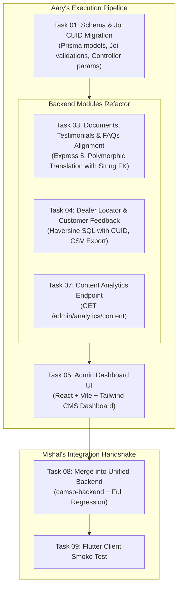

# CAMSO Engineering Plan — Aary's Implementation Roadmap

## Goal Description

Following the audit in [CAMSO_Current_State_Audit.md](file:///c:/college/3rd%20YEAR_SEM-5/RPG/Camso_mobile_app/docs/CAMSO_Current_State_Audit.md) and the work division agreed in [CAMSO_Remaining_Work_Division.md](file:///c:/college/3rd%20YEAR_SEM-5/RPG/Camso_mobile_app/docs/CAMSO_Remaining_Work_Division.md), this document establishes the exact scope division between Vishal and Aary, and provides a comprehensive, phased technical implementation plan for **Aary's deliverable scope**.

---

## 1. Executive Work Division & Audit Analysis

### A. What Has Been Completed by Vishal (Verified & Locked)
Vishal has completed and verified **10 core modules** in `camso-backend` backed by **228 passing unit tests** across 25 suites and a single unified Prisma schema with `String cuid()` primary keys:
1. **Runtime & Reliability Architecture:** Node.js 24 + Express 5 (`^5.2.1`), graceful shutdown, liveness (`/health`, `/api/v1/health`) and readiness (`/ready`, `/api/v1/ready`) probes, central `ApiError` and `errorHandler`.
2. **Customer Authentication & Token Lifecycle:** `POST /api/v1/auth/register`, `/login`, `/guest`, `/refresh`, `/logout` with short-lived JWT access tokens and hashed refresh token rotation + replay reuse detection.
3. **Customer Profile Management:** `GET /api/v1/users/me`, `PATCH /api/v1/users/me` with `authGuard`.
4. **Device Registration & Ownership:** `POST /api/v1/devices` (device ID, platform, fcm_token, app_version), `GET /api/v1/devices`, `DELETE /api/v1/devices/:id` with strict ownership check.
5. **Hierarchical Category Tree & Admin Category CMS:** `GET /api/v1/categories`, `GET /:id`, `GET /:id/products`, `GET /:id/filters` and admin endpoints (`POST`, `PATCH /api/v1/admin/categories`).
6. **Product Catalogue & Dynamic Spec Filters:** `GET /api/v1/products`, `GET /:idOrSlug`, admin CRUD (`POST /api/v1/admin/products`, `PATCH /:id`, `POST /:id/images`), specification linkings, and image metadata.
7. **6-Tier Ranked Search Engine:** `GET /api/v1/search` (Exact PID → Exact Name → Name Prefix → Category → Specification Value → Partial Substring), search history (`/recent`), and aggregated queries (`/popular`).
8. **Bookmarks & Guest-to-Account Synchronization:** `GET`, `POST`, `DELETE /api/v1/bookmarks` and `POST /api/v1/bookmarks/sync` (merging guest device bookmarks into registered accounts upon login).
9. **Language Registry & Static App Content CMS:** `GET /api/v1/languages`, admin language CRUD (`/admin/languages`), `GET /api/v1/content/:key` (about, contact, legal, settings), and `PUT /api/v1/admin/content/:key`.
10. **Catalogue Analytics:** `GET /api/v1/admin/analytics/catalogue` (top 10 searches and top 10 bookmarked products).
11. **Admin Identity & Authentication:** `AdminUser` model with CUID string IDs, `POST /api/v1/admin-auth/login`, `refresh`, `logout`, plus `adminGuard` and `requireRole` middleware.
12. **Business / Dealer Portal Foundation:** `BusinessOrganization`, `BusinessUser`, `BusinessRefreshToken`, `POST /api/v1/business-auth/*`, portal endpoints `/business/organization`, `/business/dealer/portal`, `/business/distributor/portal`, and admin approval `/admin/organizations`.

### B. What is Remaining for Vishal
1. **TASK-02 (P0 - Immediate):** Firebase Infrastructure & Media Upload Adapter (`src/config/firebase.js` and `mediaUpload.js` with local mock fallback).
2. **TASK-06 (P1 - High):** FCM Outbound Push Notification Multicast Transport (`firebase-admin` `messaging().sendEachForMulticast()`, batching max 500, dead token deactivation).
3. **TASK-08 (P0 - Integration):** Final Backend Consolidation & Routing Mount (merging Aary's verified modules into `camso-backend`, unified `prisma/schema.prisma`, mounting in `src/routes/index.js`, running combined regression suite).
4. **TASK-09 (P0 - Integration):** Flutter Customer App Connection & End-to-End Smoke Test (`CAMSO-APP-main` client screens connected to live backend).

---

### C. What Aary Specifically Has to Do

According to `CAMSO_Remaining_Work_Division.md`, Aary has full ownership of **5 tasks**:

| Task ID | Priority | Name | Description |
|---|---|---|---|
| **TASK-01** | **P0 (Immediate)** | **Unified Schema & Type Alignment** | Migrate all primary and foreign keys in Aary's Prisma schema files and Joi validations from `Int autoincrement` to `String cuid()`. Remove integer parsing across controllers and repositories. |
| **TASK-03** | **P1 (High)** | **Content CMS Alignment: Documents, Testimonials & FAQs** | Refactor `documents`, `testimonials`, and `faqs` modules to match Express 5 and CUID standard. Connect with polymorphic `Translation` entity using string IDs. |
| **TASK-04** | **P1 (High)** | **Public Dealer Proximity Locator & Feedback VOC** | Refactor `dealers` (Haversine raw SQL proximity locator) and `feedback` (VOC ratings + CSV export) to CUID standard. |
| **TASK-05** | **P1 (High)** | **Admin Dashboard UI** | Build the administrative CMS web dashboard UI (React + Vite + Tailwind CSS) enabling admins to log in, view/manage catalogue items, manage documents & FAQs, view customer feedback, and export CSV reports. |
| **TASK-07** | **P2 (Medium)** | **Content Analytics Endpoint** | Build `GET /api/v1/admin/analytics/content` calculating total document downloads, top documents, and customer feedback rating breakdown with safe zero-handling for empty states. |



---

## User Review Required

> [!IMPORTANT]
> **CUID Primary Key Convention**: All models in Aary's domain (`AdminUser`, `Document`, `DocumentFile`, `Testimonial`, `Faq`, `Dealer`, `Feedback`, `Translation`, `Notification`, `Campaign`, `MediaAsset`, `AuditLog`) will transition to `String @id @default(cuid())`. All cross-domain foreign keys (`product_id`, `category_id`, `user_id`, `admin_user_id`) will be `String?` or `String`. This is non-negotiable to prevent schema migration crashes and relational mismatches with Vishal's catalogue.

> [!IMPORTANT]
> **Admin Dashboard UI Delivery**: SOW p.1 §2.8 / p.2 §3.8 requires an administrative interface, and the audit confirmed zero UI exists currently. We propose building a responsive SPA using **React + Vite + Tailwind CSS** located in `admin-dashboard/`. It will communicate with the backend via Bearer JWT and support both development mode (`npm run dev`) and static production serving from Express (`/admin`).

> [!NOTE]
> **Local Admin-Auth Support**: In Aary's local workspace, `src/modules/auth` only contains `refreshToken.repository.js`. To make Aary's local test harness and Admin UI fully functional before Vishal's final merge, we will include a local `admin-auth` controller/service matching the frozen API contract (`POST /api/v1/admin-auth/login`).

---

## Open Questions

1. **Admin Dashboard UI Tech Stack**:
   - Proposed: **React 18 + Vite + Tailwind CSS + Lucide Icons**.
   - Do you agree with this stack, or do you have any specific UI library preferences (e.g. Next.js, plain HTML/Bootstrap, Flutter Web)? *(React + Vite + Tailwind provides the fastest development turnaround and cleanest CMS experience).*
2. **CUID Validation Regex vs String Trim**:
   - For Joi schema validation, we recommend `Joi.string().trim().min(20).max(36)` to support both standard CUIDs and mocked test IDs without strict 25-character regex failures during testing. Please confirm.

---

## Proposed Changes

---

### Component 1: Schema & Type Alignment (TASK-01)

#### [MODIFY] [content.prisma](file:///c:/college/3rd%20YEAR_SEM-5/RPG/Camso_mobile_app/prisma/schema/content.prisma)
- Change `AdminUser.id` from `Int @id @default(autoincrement())` to `String @id @default(cuid())`.
- Change `Document.id` to `String @id @default(cuid())`, `product_id String?`, `category_id String?`, `created_by String`.
- Change `DocumentFile.id` to `String @id @default(cuid())`, `document_id String`.
- Change `Testimonial.id` to `String @id @default(cuid())`, `product_id String?`, `created_by String`.
- Change `Faq.id` to `String @id @default(cuid())`, `product_id String?`, `category_id String?`, `created_by String`.
- Change `Dealer.id` to `String @id @default(cuid())`, `created_by String`.
- Change `Feedback.id` to `String @id @default(cuid())`, `user_id String?`.

```prisma
// Example Schema Transformation in content.prisma:
model Document {
  id            String       @id @default(cuid())
  product_id    String?
  category_id   String?
  created_by    String
  title         String       @db.VarChar(255)
  document_type DocumentType
  is_published  Boolean      @default(false)
  created_at    DateTime     @default(now())
  updated_at    DateTime     @updatedAt

  files         DocumentFile[]
  admin_user    AdminUser    @relation(fields: [created_by], references: [id])

  @@index([product_id])
  @@index([category_id])
  @@index([document_type])
  @@index([is_published])
  @@map("documents")
}
```

#### [MODIFY] [core.prisma](file:///c:/college/3rd%20YEAR_SEM-5/RPG/Camso_mobile_app/prisma/schema/core.prisma)
- Change `Translation.id` to `String @id @default(cuid())` and `entity_id` from `Int` to `String`. This is critical so polymorphic translations can attach to products, categories, documents, and notifications.
- Change `MediaAsset.id` to `String @id @default(cuid())`, `uploaded_by String`.
- Change `AuditLog.id` to `String @id @default(cuid())`, `actor_id String`, `entity_id String?`.
- Change `RefreshToken.id` to `String @id @default(cuid())`, `admin_user_id String?`, `user_id String?`.

#### [MODIFY] [engagement.prisma](file:///c:/college/3rd%20YEAR_SEM-5/RPG/Camso_mobile_app/prisma/schema/engagement.prisma)
- Change `Notification.id` to `String @id @default(cuid())`, `product_id String?`, `campaign_id String?`, `created_by String`.
- Change `Campaign.id` to `String @id @default(cuid())`, `created_by String`.

#### [MODIFY] [catalogue.prisma](file:///c:/college/3rd%20YEAR_SEM-5/RPG/Camso_mobile_app/prisma/schema/catalogue.prisma) & [search.prisma](file:///c:/college/3rd%20YEAR_SEM-5/RPG/Camso_mobile_app/prisma/schema/search.prisma)
- Reconcile `Product`, `Category`, `User`, `Bookmark` model definitions to `String @id @default(cuid())` to match Vishal's baseline models.

#### [NEW] [src/core/utils/idValidation.js](file:///c:/college/3rd%20YEAR_SEM-5/RPG/Camso_mobile_app/src/core/utils/idValidation.js)
- Reusable Joi validation rules for CUID strings:
```javascript
const Joi = require('joi');

const cuidSchema = Joi.string().trim().min(20).max(36);
const cuidRequired = cuidSchema.required();
const cuidOptional = cuidSchema.optional().allow(null, '');

module.exports = { cuidSchema, cuidRequired, cuidOptional };
```

---

### Component 2: Content CMS Modules Alignment (TASK-03)

#### [MODIFY] [src/modules/documents/documents.validation.js](file:///c:/college/3rd%20YEAR_SEM-5/RPG/Camso_mobile_app/src/modules/documents/documents.validation.js)
- Update `product_id`, `category_id`, and `id` from `Joi.number().integer().positive()` to `cuidSchema`.
- Remove any integer coercion.

#### [MODIFY] [src/modules/documents/documents.controller.js](file:///c:/college/3rd%20YEAR_SEM-5/RPG/Camso_mobile_app/src/modules/documents/documents.controller.js), `documents.service.js`, `documents.repository.js`
- Pass string `id`, `product_id`, and `category_id` directly without `parseInt`.
- Ensure repository Prisma queries (`where: { id }`, `where: { product_id }`) use string values.

#### [MODIFY] [src/modules/testimonials/testimonials.validation.js](file:///c:/college/3rd%20YEAR_SEM-5/RPG/Camso_mobile_app/src/modules/testimonials/testimonials.validation.js), `testimonials.controller.js`, `testimonials.service.js`, `testimonials.repository.js`
- Update testimonial validation and repository queries to use CUID string `id` and `product_id`.

#### [MODIFY] [src/modules/faqs/faqs.validation.js](file:///c:/college/3rd%20YEAR_SEM-5/RPG/Camso_mobile_app/src/modules/faqs/faqs.validation.js), `faqs.controller.js`, `faqs.service.js`, `faqs.repository.js`
- Update FAQ validation and repository queries to use CUID string `id`, `category_id`, and `product_id`.

#### [MODIFY] [src/core/utils/translate.js](file:///c:/college/3rd%20YEAR_SEM-5/RPG/Camso_mobile_app/src/core/utils/translate.js)
- Update `translateEntities` and `translateEntity` to accept string `entity_id` values and query `Translation` table accordingly.

---

### Component 3: Dealer Proximity Locator & Feedback VOC (TASK-04)

#### [MODIFY] [src/modules/dealers/dealers.validation.js](file:///c:/college/3rd%20YEAR_SEM-5/RPG/Camso_mobile_app/src/modules/dealers/dealers.validation.js), `dealers.controller.js`, `dealers.service.js`, `dealers.repository.js`
- Update `id` validation to CUID string.
- In `dealers.repository.js`, update Haversine SQL formula query to return and cast `id` as string.
- Retain sorting without non-existent `created_at` field.

#### [MODIFY] [src/modules/feedback/feedback.validation.js](file:///c:/college/3rd%20YEAR_SEM-5/RPG/Camso_mobile_app/src/modules/feedback/feedback.validation.js), `feedback.controller.js`, `feedback.service.js`, `feedback.repository.js`
- Update `user_id` to accept nullable CUID string.
- Verify CSV export endpoint `GET /api/v1/admin/feedback/export?format=csv` generates valid comma-separated values, sets `Content-Type: text/csv; charset=utf-8`, and handles special characters safely.

---

### Component 4: Content Analytics Feature (TASK-07)

#### [NEW] [src/modules/analytics/content-analytics.routes.js](file:///c:/college/3rd%20YEAR_SEM-5/RPG/Camso_mobile_app/src/modules/analytics/content-analytics.routes.js)
- Express route mounting: `GET /api/v1/admin/analytics/content`.
- Protected by `adminGuard` and `requireRole(['SUPER_ADMIN', 'CONTENT_ADMIN', 'VIEWER'])`.

#### [NEW] [src/modules/analytics/content-analytics.controller.js](file:///c:/college/3rd%20YEAR_SEM-5/RPG/Camso_mobile_app/src/modules/analytics/content-analytics.controller.js)
- Handler invoking `contentAnalyticsService.getContentMetrics()`.

#### [NEW] [src/modules/analytics/content-analytics.service.js](file:///c:/college/3rd%20YEAR_SEM-5/RPG/Camso_mobile_app/src/modules/analytics/content-analytics.service.js)
- Calculates:
  1. Total document downloads & Top 10 downloaded documents.
  2. Customer feedback summary (total feedback count, average rating, 1–5 star rating distribution, category breakdown: `PRODUCT`, `SERVICE`, `PRICING`).
  3. Safe zeroed defaults when database tables are empty.

#### [NEW] [tests/unit/content-analytics.test.js](file:///c:/college/3rd%20YEAR_SEM-5/RPG/Camso_mobile_app/tests/unit/content-analytics.test.js)
- Unit tests verifying calculations and empty-state resilience.

---

### Component 5: Admin Dashboard UI (TASK-05)

#### [NEW] Directory: `admin-dashboard/`
Build a high-performance modern web application using **Vite + React + Tailwind CSS**:

1. **Authentication & Session:**
   - [NEW] `admin-dashboard/src/pages/Login.jsx`: Admin email/password form connecting to `POST /api/v1/admin-auth/login`. Stores JWT Bearer token in session/localStorage and sets active role (`SUPER_ADMIN`, `CONTENT_ADMIN`, `MARKETING`, `VIEWER`).
   - [NEW] `admin-dashboard/src/context/AuthContext.jsx`: Auth state provider with auto-logout on 401 token expiry.
   - [NEW] `admin-dashboard/src/api/client.js`: Axios/Fetch API client injecting `Authorization: Bearer <token>` and standardized error toast notifications.

2. **Dashboard Overview:**
   - [NEW] `admin-dashboard/src/pages/DashboardOverview.jsx`: Metrics cards (Total Products, Active Documents, Feedback Average Rating, Active Campaigns), Top Searched Queries list, Top Downloaded Documents list, and Feedback Star Rating breakdown chart.

3. **Catalogue & Products View:**
   - [NEW] `admin-dashboard/src/pages/CatalogueManager.jsx`: Category hierarchy tree navigation, searchable product table, view/edit product attributes, and specification details.

4. **Support Documents CMS View:**
   - [NEW] `admin-dashboard/src/pages/DocumentsManager.jsx`: Table of support documents with filter by type (`CATALOGUE`, `MANUAL`, `BROCHURE`, etc.), toggle `is_published` switch, create document modal, and file upload interface.

5. **FAQs & Testimonials View:**
   - [NEW] `admin-dashboard/src/pages/FaqManager.jsx`: FAQ listing with question/answer preview, category filter, and create/edit modal.
   - [NEW] `admin-dashboard/src/pages/TestimonialsManager.jsx`: Customer testimonials table with publish toggles.

6. **Dealer Directory View:**
   - [NEW] `admin-dashboard/src/pages/DealersManager.jsx`: Searchable list of dealers, country filter, active status toggle (`is_active`), and CSR contact view.

7. **Voice of Customer (Feedback) View:**
   - [NEW] `admin-dashboard/src/pages/FeedbackManager.jsx`: Customer feedback cards with star ratings, category filters, and a one-click **"Export to CSV"** button downloading live data from `/api/v1/admin/feedback/export?format=csv`.

8. **Campaign & Notification Monitor:**
   - [NEW] `admin-dashboard/src/pages/CampaignsManager.jsx`: Campaign listing showing targeting audience criteria and delivery status.

---

## Verification Plan

### Automated Tests
1. **Prisma Schema Validation**:
   - Verify multi-file schema integrity after CUID changes:
     ```powershell
     npm run prisma:validate
     ```
2. **Unit Test Suite**:
   - Run unit tests for validation schemas, services, and analytics:
     ```powershell
     npm test tests/unit/
     ```
3. **Integration Test Suite**:
   - Run integration tests with string CUIDs:
     ```powershell
     npm test tests/integration/adminCms.test.js
     npm test tests/integration/adminDays910.test.js
     npm test tests/integration/publicContent.test.js
     npm test tests/integration/publicEngagement.test.js
     ```
   - Target: **100% assertions passed**.

### Manual Verification
1. **Admin Dashboard UI Walkthrough**:
   - Start the backend and UI:
     - Backend: `npm run dev`
     - Admin Dashboard: `cd admin-dashboard; npm run dev`
   - Log in using admin credentials (`admin@example.com` / `admin123`).
   - Create a test support document, attach a file, and verify it appears in the public `/api/v1/documents` endpoint.
   - Submit customer feedback and click "Export CSV" in the Admin Dashboard to verify CSV file download.
   - Verify the Content Analytics dashboard displays accurate document download counters and feedback rating breakdown.
